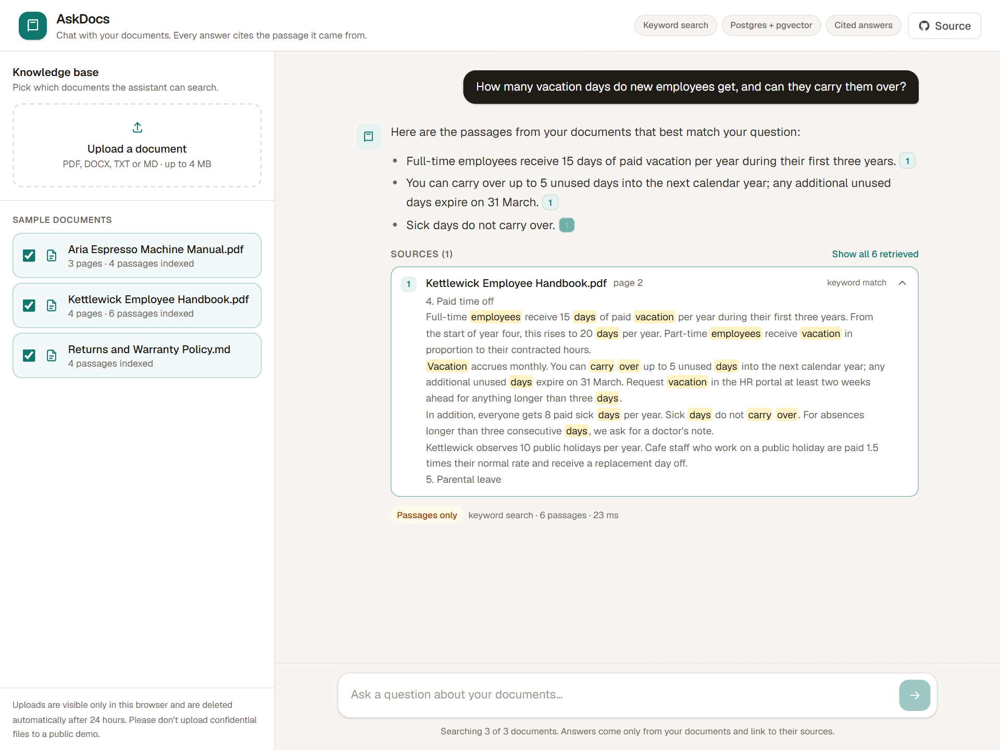
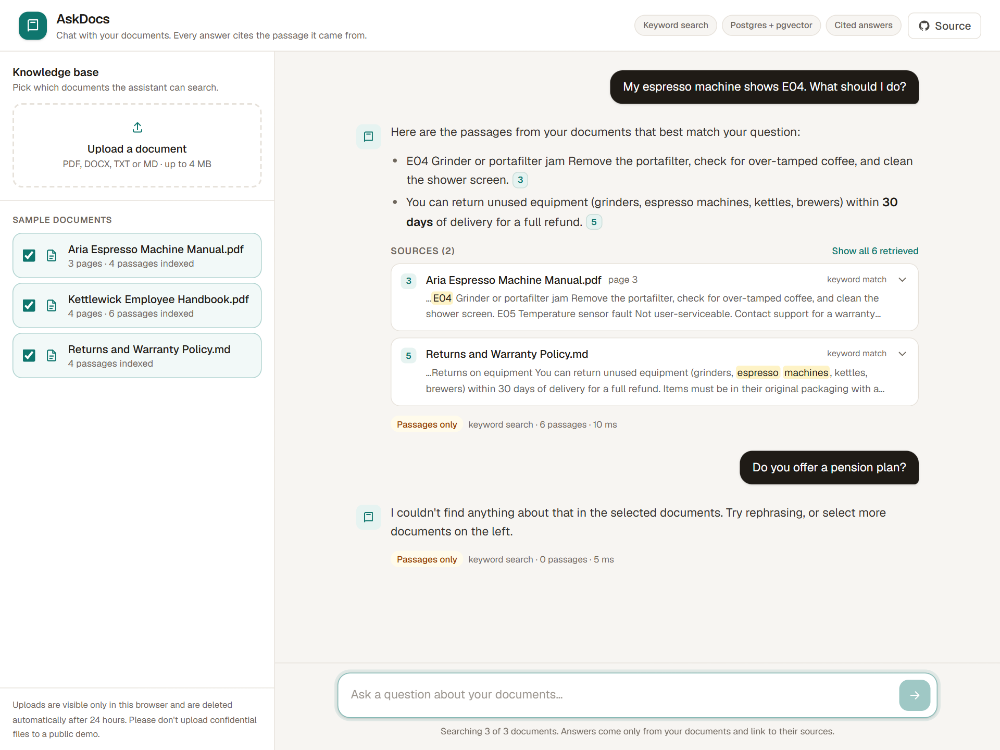
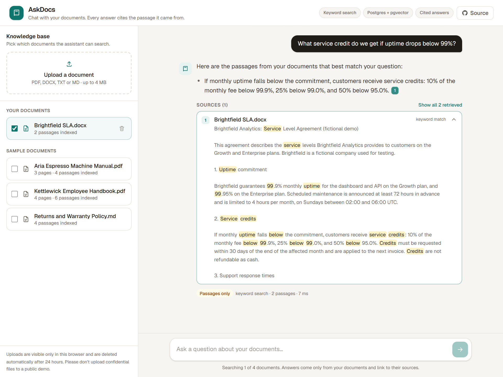
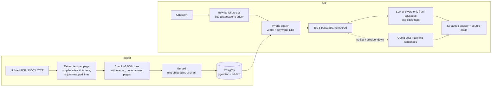

# AskDocs: a RAG chatbot that cites its sources

Upload PDFs, Word files or text, then ask questions in plain English. AskDocs answers
**only from your documents**, and every claim links to the exact passage (and page)
it came from, so you can check the answer instead of trusting it.

**Live demo:** [rag-docs-chatbot-pi.vercel.app](https://rag-docs-chatbot-pi.vercel.app) · Three sample documents are preloaded, so you can try it
without uploading anything.



## What it does

- **Chat with your documents.** PDF, DOCX, TXT and Markdown. Answers stream in as they're written.
- **Citations you can click.** Each `[1]` in an answer opens the source passage, with the file name, page number and the matching words highlighted.
- **Says "I don't know".** If the documents don't cover a question, it says so instead of making something up.
- **Follow-up questions work.** "And after three years?" is rewritten into a full search query using the conversation so far.
- **Hybrid search.** Semantic search finds paraphrases ("time off" matches "vacation days"). Keyword search finds exact terms that embeddings blur, such as error codes, SKUs and names. The two result lists are merged with Reciprocal Rank Fusion.
- **Keeps working when the AI doesn't.** With no API key, or if the AI provider is down or out of credit, it falls back to keyword search and answers with the best-matching sentences, still cited. Nothing breaks, and nothing is made up.
- **Choose what to search.** Tick the documents the assistant may use for each question.
- **Built for a public demo.** Per-visitor workspaces, rate limits, a daily spend cap, file size and page limits, and uploads that delete themselves after 24 hours.

| Cited answer | Honest "not found" | Your own Word file |
|---|---|---|
|  |  |  |

## Two modes

| | **AI mode** (API key set) | **Passages-only mode** (no key) |
|---|---|---|
| Search | Hybrid: pgvector semantic + Postgres full-text | Postgres full-text |
| Answer | Written by the LLM from the retrieved passages, with `[n]` citations | The best-matching sentences, quoted with `[n]` citations |
| Cost | About $0.0004 per question | $0 |

The mode is picked automatically. Add a key later and the app embeds any documents
that were indexed without vectors on its next request, so nothing needs re-uploading.

## How it works



1. **Ingest.** Text is extracted page by page (`unpdf` for PDFs, `mammoth` for Word). Running headers and footers that repeat on most pages are removed, and lines the PDF wrapped mid-sentence are joined back up. Text is split into ~1,000-character chunks along paragraph, line and sentence boundaries, with a small overlap. Each chunk is embedded and stored in Postgres with its page number.
2. **Retrieve.** The question is embedded and matched two ways in one SQL query: cosine similarity with pgvector, and Postgres full-text search. The ranks are fused, and the top 6 passages go to the model.
3. **Answer.** The model is told to use only the numbered passages, cite every claim, say clearly when the answer isn't there, and ignore any instructions hidden inside documents (a basic prompt-injection guard). Without a model, sentences are scored by how many of the question's specific words they contain, with rare words such as codes and names counting most.
4. **Show.** The UI streams the answer, turns `[n]` markers into clickable chips, and lists the cited passages underneath with the question's words highlighted.

## Tech stack

| Layer | Choice | Why |
|---|---|---|
| App | Next.js 16 (App Router), React 19, TypeScript, Tailwind CSS 4 | One codebase for UI and API, deploys to Vercel's free tier |
| Vector store | Postgres + pgvector (e.g. Neon's free tier) | One database for vectors, keyword search and app data. No extra vector service to pay for |
| Embedded database | PGlite (Postgres compiled to WASM, with pgvector) | Runs with zero setup locally, and on Vercel when no database is configured |
| LLM | `google/gemini-2.5-flash-lite` via OpenRouter | Fast and very cheap. Any OpenAI-compatible model works through one env var |
| Embeddings | `openai/text-embedding-3-small` (1,536 dims) via OpenRouter | $0.02 per million tokens |

## Running costs

At demo scale this costs close to nothing:

- **Answering a question:** about 3,000 input tokens and 300 output tokens, roughly **$0.0004**. That's about 2,500 questions per dollar.
- **Indexing a 50-page PDF:** about 25,000 tokens to embed, roughly **$0.0005**.
- **Hosting:** Vercel Hobby plus Neon's free tier: $0.

A daily cap (`CHATS_PER_DAY_GLOBAL`, default 2,000) puts a hard ceiling on what a public demo can spend.

## Run it locally

Requirements: Node.js 20 or newer. An [OpenRouter](https://openrouter.ai/keys) or OpenAI API key is optional.

```bash
git clone https://github.com/saminul-amin/rag-docs-chatbot.git
cd rag-docs-chatbot
npm install
cp .env.example .env.local   # optional: add OPENROUTER_API_KEY for AI mode
npm run dev                  # http://localhost:3000
```

With `DATABASE_URL` left empty, the app uses an embedded PGlite database in `./.data`.
The sample documents are indexed automatically on first load.

```bash
npm run eval          # 11 test questions: retrieval hit rate + answer checks
npm run typecheck
npm run lint
npm run screenshots   # re-shoot docs/screenshots against a running server
```

## Deploy to Vercel (free)

1. Import this repo into Vercel and deploy. It works as-is, in passages-only mode, with a temporary database.
2. For permanent storage, add a free Postgres database: Vercel dashboard → Storage → Neon, connected to the project. That sets `DATABASE_URL`. pgvector is built in, and the app creates its own tables.
3. For AI answers, add `OPENROUTER_API_KEY` (or `OPENAI_API_KEY`) in Project Settings → Environment Variables, then redeploy.

All settings are listed in [`.env.example`](.env.example): models, chunk size, number of passages, rate limits, file limits and retention time.

## Project structure

```
src/
  app/api/documents/     upload (POST), list (GET), delete (DELETE /[id])
  app/api/chat/          question -> retrieval -> streamed, cited answer (NDJSON)
  components/            chat UI, citation chips, source cards, document panel
  lib/parse.ts           PDF / DOCX / TXT extraction, header/footer removal, line re-flow
  lib/chunk.ts           boundary-aware chunking with overlap
  lib/retrieve.ts        hybrid pgvector + full-text search with RRF
  lib/chat.ts            prompts, follow-up rewriting, streaming
  lib/extractive.ts      cited answers without an LLM (fallback mode)
  lib/db.ts              Postgres or PGlite behind one small interface
  lib/rate-limit.ts      per-IP and global limits (IPs stored hashed)
scripts/eval.ts          quality check against the sample documents
scripts/screenshots.mjs  README / portfolio screenshots with Playwright
sample-docs/             fictional company documents used by the demo
```

## Adapting it for a business

This demo is the core of what most "chatbot over our documents" projects need. Typical
next steps for a real deployment:

- **User accounts and teams** (Clerk, Auth.js or Supabase Auth) instead of per-browser workspaces
- **More sources:** Google Drive, Notion, Confluence, websites, help-desk articles, with scheduled re-syncing
- **OCR** for scanned PDFs, and table-aware parsing for spreadsheets
- **A website widget** or a Slack / WhatsApp / Teams bot on the same backend
- **Analytics:** questions people ask, unanswered questions, thumbs up/down feedback
- **Re-ranking** with a cross-encoder for large document sets
- **Data residency:** self-hosted models or a specific region, if documents are sensitive

## About the sample documents

Kettlewick Coffee Co. and Brightfield Analytics are **fictional companies** made up for
this demo. Their documents were written for testing: the samples are generated by
[`scripts/make-sample-docs.py`](scripts/make-sample-docs.py), and the Word file used in
the upload screenshot is in [`scripts/fixtures/`](scripts/fixtures/).

---

Built by **Md. Saminul Amin**, AI engineer (TypeScript, Python, Postgres).
Need a chatbot over your own documents, or AI inside your product?
[Hire me on Upwork](https://www.upwork.com/freelancers/~01250e9542bce43351).
